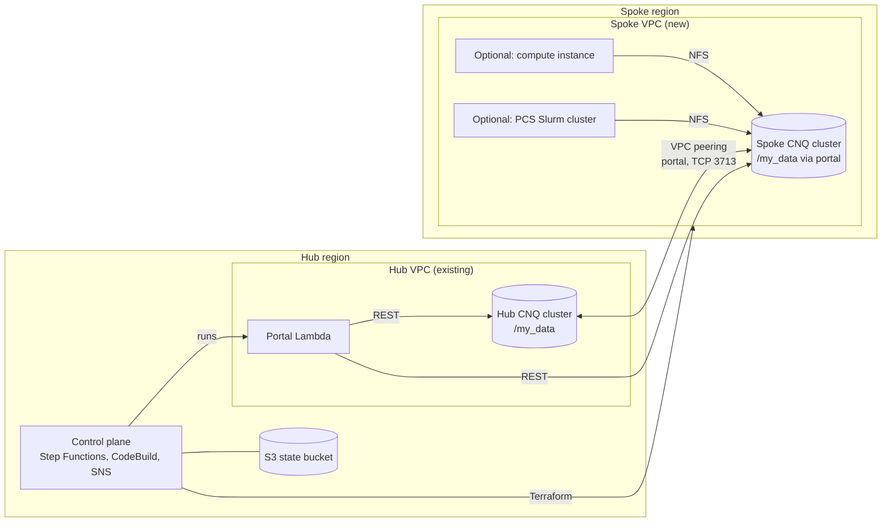

# cnq-path-extender

Run compute in another AWS region against data that stays where it is.

cnq-path-extender takes a directory on an existing Cloud Native Qumulo (CNQ) cluster in
AWS and makes it readable and writable in another AWS region, in one step, without
copying the data first. Optionally, it also sets up compute next to it: a single
instance (GPU types included) or a Slurm cluster with a genomics pipeline ready to run.

## Why

Compute capacity isn't always where the data is. GPU instances, or large numbers of
cores for an HPC burst, are often easier to get in another region. Moving terabytes of
input there first, and the results back afterwards, costs time and money, and leaves
copies to keep in sync.

CNQ's Cloud Data Fabric solves this with **portals**: a **spoke** cluster in the other
region presents a directory of the **hub** cluster as if it were local, without copying
anything up front. When a client on the spoke reads a file, the spoke pulls only the blocks
that read needs from the hub and caches them. NeuralCache, Qumulo's predictive
prefetch, learns the access pattern and pulls the blocks likely to be read next before
they're asked for. A large file never has to cross regions in full. On a read-write
portal, writes are committed on the spoke and synchronized to the hub in the background,
sending only the changed blocks, and Qumulo's locking keeps both sides strictly
consistent. The hub always holds the authoritative copy; the spoke's cache is evicted as
space is needed.
A genomics pipeline in another region can then read its FASTQs from the hub and write its
results back to it, with no bulk copy.

Setting that up by hand means a new VPC, cross-region peering, routes and security group
rules on both sides, a new CNQ cluster at the hub's exact version, and the portal
handshake. This tool does all of it from one command, and removes it all with another.

## How it works

A **control plane** is deployed once per hub, in the hub's account and region. To launch
a spoke, you start a Step Functions workflow with a region, a path on the hub, and an
address range for the spoke's VPC. The workflow:

1. checks the request (region, quotas, path, CIDR overlaps, hub identity and version);
2. builds a VPC in the target region and peers it with the hub's VPC (Terraform, in
   CodeBuild);
3. builds a CNQ spoke cluster there at the hub's Qumulo Core version (Terraform, with
   the Qumulo provider);
4. creates the portal on the spoke, authorizes it on the hub, and verifies it (Python
   Lambda, Qumulo REST API);
5. optionally launches a compute instance or a PCS (Slurm) cluster that mounts the spoke;
6. emails the result.



Removing a spoke is another workflow: it deletes the portal, destroys the stacks, sweeps
anything left that carries the spoke's tags, and checks that nothing remains.

See [architecture](docs/architecture.md) for the design.

## Prerequisites

- **An existing CNQ hub cluster in AWS, deployed with the
  [Qumulo Terraform provider](https://github.com/Qumulo/qumulo-terraform-aws)** and
  running. You need its `deployment_unique_name` output, the ARN of the Secrets Manager
  secret holding its admin password, and access to change its Terraform (one change,
  below).
- **A supported Qumulo Core version on the hub.** Spokes are built at the hub's exact
  version and the portal uses the v2 portal REST API. It has only been tested on Qumulo
  Core 7.10.1.1.
- **Access to the Qumulo Terraform provider registry**
  (`qumulo-terraform-registry.s3.us-east-1.amazonaws.com`) from CodeBuild.
- **Terraform 1.11 or later** and the **AWS CLI** on your machine.
- **Administrator-level AWS credentials** for the hub's account. Bootstrap creates IAM
  roles, including the admin-equivalent CodeBuild role.
- **An existing S3 bucket** for Terraform state, in the hub's region: versioned,
  encrypted, and restricted. Spoke state holds generated admin passwords and SSH keys.
- **NAT for the hub's subnets.** The Lambda runs there and reaches AWS APIs through NAT.
- **On-Demand vCPU quota** in each target region for the spoke's instance family (and
  for the compute instance or PCS nodes, if you use them).
- **One change to the hub's Terraform:** add the control plane's CDF security group to
  the hub's `additional_security_group_ids`. It's an in-place update; confirm with
  `terraform plan` before applying.

Full list, including required organization tags and choosing address ranges: see the
[deployment guide](docs/deployment-guide.md#before-you-start).

## Quickstart

1. Fill in the settings:

   ```bash
   cp bootstrap/terraform.tfvars.example bootstrap/terraform.tfvars
   ```

   Edit `bootstrap/terraform.tfvars`: `hub_region`, `hub_deployment_unique_name`
   (e.g. `myhub-abc123`), `hub_admin_secret_arn`, `state_bucket`, `notification_email`.

2. Deploy the control plane:

   ```bash
   cd bootstrap
   terraform init -backend-config=bucket=<state_bucket> -backend-config=region=<hub_region> -backend-config=key=<hub_deployment_unique_name>/bootstrap/terraform.tfstate
   terraform apply
   ```

   Confirm the SNS subscription email that arrives.

3. Attach the CDF security group to the hub. In the **hub's** Terraform, add the
   `cdf_security_group_id` output to `additional_security_group_ids`, keeping the groups
   already there. Run `terraform plan`, confirm `~ update in-place`, then
   `terraform apply`.

4. Launch a spoke:

   ```bash
   aws stepfunctions start-execution --region <hub_region> --state-machine-arn <deploy_spoke_state_machine_arn> --input '{"region": "eu-central-1", "path": "/my_data", "vpc_cidr": "10.20.0.0/16"}'
   ```

   Instead of `region`, `"placement": {}` lets the tool pick the nearest region where
   the cluster fits. The email arrives when the portal is up.

5. Remove it when done:

   ```bash
   aws stepfunctions start-execution --region <hub_region> --state-machine-arn <destroy_spoke_state_machine_arn> --input '{"region": "eu-central-1"}'
   ```

Details for every step and input: [deployment guide](docs/deployment-guide.md).

## Costs

> [!WARNING]
> **This tool starts resources that bill by the hour, and nothing stops them for you.**
>
> - A **spoke cluster runs 24/7** until you run destroy-spoke, whether or not anything
>   uses it. The default size is 3 × i7i.8xlarge.
> - **GPU instances are expensive**: large types cost tens of dollars an hour.
> - A **capacity reservation** for the compute instance **bills from the moment it's
>   made**, before the spoke is built.
> - A PCS cluster's **controller and login node are always on** until the spoke is
>   removed.
> - **Nothing is destroyed automatically on failure.** A failed launch leaves what it
>   built, running, until you resume it or run destroy-spoke.
>
> Qumulo licensing is separate. See [costs](docs/deployment-guide.md#costs-at-a-glance).

## Optional modules

Each is off unless its key is in the launch input.

| Module | Input | What you get |
|---|---|---|
| Placement | `placement` | The tool picks the region: nearest the hub first, or from your list. With a compute instance, the first zone where its capacity can be reserved. |
| Compute instance | `compute` | One instance of any type (GPU types included) in the spoke's VPC, with the path mounted. [Details](docs/deployment-guide.md#optional-a-compute-instance) |
| Application | `compute.application` | Software set up on the instance at boot. Included: NVIDIA Parabricks. [Adding one](lambdas/portal/apps/README.md) |
| PCS cluster | `pcs` | An AWS Parallel Computing Service (Slurm) cluster: a login node and compute nodes that scale from zero, every node mounting the spoke. [Details](docs/deployment-guide.md#optional-a-pcs-cluster-slurm-with-a-pipeline) |
| Pipeline | `pcs.pipeline` | A Nextflow pipeline and run commands on the login node. Included: nf-core/sarek, Roche SBX Xoos. [Pipelines](spoke/pcs/pipelines/README.md) |
| Client resources | `client_resources` | A security group and Session Manager role in the spoke VPC, for instances you launch yourself. |
| Local mode | `deploy-local` workflow | The compute instance and PCS modules in the hub's own VPC, mounting the hub directly: a same-region baseline. [Local mode](docs/local-mode.md) |

## Limitations

- **One spoke per region per hub.** State, names and peering are keyed by region.
- **Spokes don't follow hub upgrades.** A spoke is built at the hub's version. When the
  hub is upgraded, upgrade existing spokes yourself (Qumulo UI or API).
- **The CodeBuild role is admin-equivalent.** It has wildcard permissions on EC2, IAM,
  KMS, S3 and more, because the Qumulo provider creates IAM roles, KMS keys and buckets.
  Anyone who can change the code bundle in the state bucket, or start builds, can act as
  an administrator in the account.
- **PCS uses AWS's sample AMI,** which AWS doesn't support for production use.
- **PCS is x86_64 only.**
- **Local mode loads the hub.** Every local compute node reads and writes the hub
  directly, alongside the hub's other users.
- **It sets up environments; it never runs workloads.** Running jobs and collecting
  results is up to you.
- **Stopped spokes can't be destroyed.** Start the spoke's instances first. See
  [known issues](docs/known-issues.md).

## Documentation

| Document | What's in it |
|---|---|
| [Deployment guide](docs/deployment-guide.md) | Setting up the control plane, launching and removing spokes, every input, troubleshooting, updating, costs |
| [Architecture](docs/architecture.md) | Design, modules, workflows, removal, naming, security model |
| [Known issues](docs/known-issues.md) | Behavior you may hit and what to do |
| [Local mode](docs/local-mode.md) | Running the modules next to the hub |
| [Applications](lambdas/portal/apps/README.md) | Writing an application for the compute instance |
| [Pipelines](spoke/pcs/pipelines/README.md) | How PCS pipelines are set up, and adding one |

## Repository layout

```
bootstrap/          Terraform: the control plane, deployed once per hub
spoke/network/      Terraform: spoke VPC, peering, CDF rule, secrets
spoke/cluster/      Terraform: the CNQ spoke cluster
spoke/pcs/          Terraform: the optional PCS cluster, node setup, pipelines
spoke/local/        Local mode: client stack, CodeBuild steps, cleanup
spoke/cleanup.py    Finds (and on destroy removes) anything a spoke left behind
lambdas/portal/     Python Lambda: validation, placement, portal, compute instance
workflows/          Step Functions definitions
scripts/            Read-only check after removing the control plane
docs/               Documentation
```

## Status and support

**This is sample code. It is NOT a supported Qumulo product.** Qumulo does not support
it, and Qumulo Care can't help with it. It is provided as-is, with no warranty, to show
one way to extend a CNQ cluster's data into another region. Review it before you run it:
it creates AWS resources that cost money in your account, and you are responsible for
them. It has only been tested on Qumulo Core 7.10.1.1.

## License

Public domain, under the [Unlicense](LICENSE).
